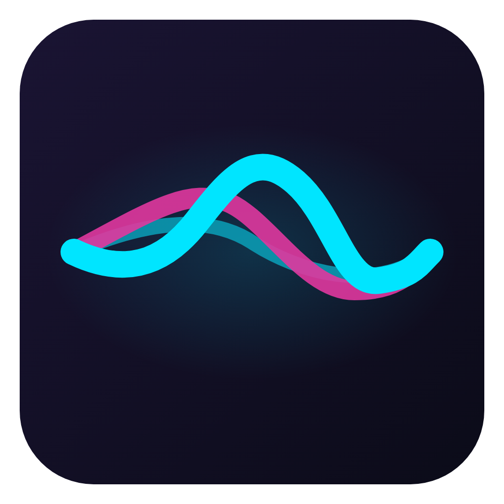
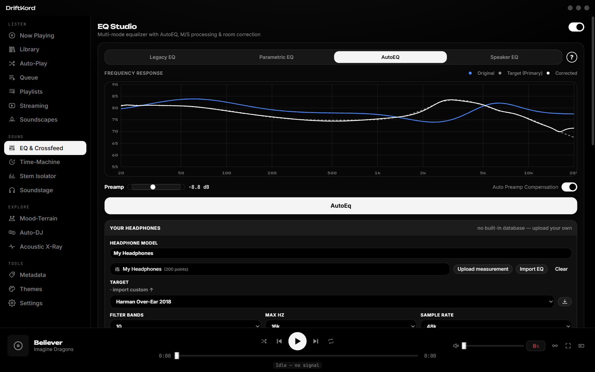
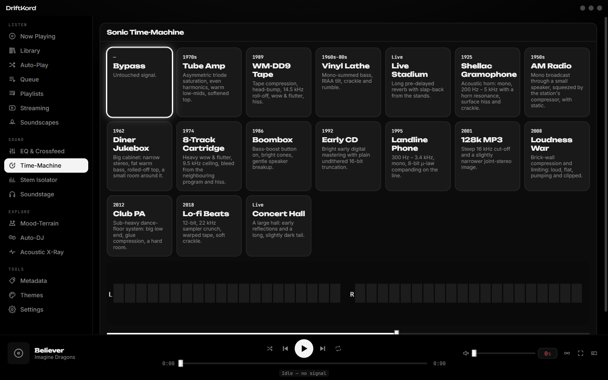

<p align="center">
  
</p>

<h1 align="center">DriftKord</h1>

<p align="center">
  <b>A bit-perfect, deeply customisable music player for Windows 11.</b><br>
  Local hi-res files, Dolby Atmos, DSD and your streaming services in one place, with a studio-grade EQ,
  synced lyrics, music videos and 57 complete themes.
</p>

<p align="center">
  
  
  
  
  
</p>

<p align="center">
  
  
</p>

---

## Download

Go to **[Releases](../../releases/latest)** and download one of these:

| File | What it is |
|---|---|
| `DriftKord-Setup.exe` | Installer: Start-menu entry and uninstaller, per user, no admin needed |
| `DriftKord.exe` | Portable app: a single file, no install, run it from anywhere |

You need Windows 10 (version 1809 or later) or Windows 11, 64-bit. Windows 11 already includes the WebView2 runtime; the installer adds it if it's missing.

> Windows SmartScreen may warn that the app is unrecognised, because it isn't code-signed. Click **More info → Run anyway**.

---

## Why DriftKord?

- **It sounds exactly like the file.** WASAPI Exclusive and native ASIO switch your DAC to each track's own sample rate and bit depth. With DSP off, a **BIT-PERFECT** badge confirms that nothing touched the signal.
- **Everything is in one player.** Your FLAC/DSD library, Dolby Atmos files, and YouTube Music, Spotify, Apple Music, TIDAL and Amazon Music all share one queue, one player bar, the same lyrics and the same visualizers.
- **It looks the way you want.** 57 themes change the whole interface (layout, controls, window chrome, fonts and motion), not just the colours. A Vivaldi-style Custom theme lets you change every element yourself.

---

## Features

### Playback engine (Rust)
- **Outputs:** WASAPI Exclusive (bit-perfect, automatic sample-rate and bit-depth switching), WASAPI Shared, and **native ASIO**. The ASIO host loads your DAC's driver directly, so no SDK is needed.
- **Gapless playback** with sample-accurate hand-over, or crossfades with tempo matching.
- **RAM playback:** each track, and the next one, is loaded fully into memory, so nothing is read from disk during playback.
- **High-precision resampler:** a polyphase windowed-sinc (Kaiser) resampler, used only when the device can't switch to the file's rate.
- **ReplayGain** for tracks and albums, with clipping protection, plus a ReplayGain scanner and tag writer.
- **Playback speed from 0.01× to 100×**, with optional **pitch preservation** (WSOLA time-stretch).
- **Mono** output and an **exponential (logarithmic) volume curve**.

### Formats
- **Lossless:** FLAC, WAV, ALAC, AIFF, APE (Monkey's Audio), WavPack, TTA.
- **Lossy:** MP3, AAC/M4A, Ogg Vorbis, Opus, WMA.
- **DSD:** `.dsf`, `.dff` and **SACD `.iso`** images (plain DSD), DSD64 to DSD512, sent as **DoP** to DSD-capable DACs or converted to PCM.
- **CUE sheets:** single-file album images appear as separate tracks with titles, artists and track numbers.
- **Dolby Atmos:** E-AC-3 (`.ec3`, `.mp4`, `.m4a`) through Windows' built-in Dolby decoder, and Dolby TrueHD (`.mka`, `.mkv`, `.thd`) through FFmpeg. Rendered to **binaural** for headphones or downmixed for speakers. Other multichannel files (5.1, 7.1, 7.1.4) are handled the same way.
- **DTS, Dolby Digital and more** are decoded by FFmpeg when it's installed (optional).

### EQ Studio
- **Legacy EQ:** a graphic EQ with any number of bands from 3 to 31 and a custom frequency range. It exports to Equalizer APO.
- **Parametric EQ:** peak, low and high shelf, low and high pass, band pass, notch and all-pass filters. Each filter can act on **both channels, left only, right only, mid or side**. You can drag filters on the graph, and choose from 22 presets and saved profiles.
- **AutoEQ:** upload *your own* headphone measurement, pick a target (Harman Over-Ear 2018, Harman In-Ear 2019, Diffuse Field, Flat or a custom one), and DriftKord fits the filters itself. You can also import a ready-made Equalizer APO, `ParametricEQ.txt` or `GraphicEQ.txt` file. No headphone database is bundled.
- **Speaker EQ (room correction):** import REW or CSV measurements per channel, or **measure with a microphone** (logarithmic sweep). Corrections apply only between a bass limit and a room limit, toward Harman In-Room or B&K targets.
- **Auto preamp** prevents clipping, and the response graph shows the original, target and corrected curves.

### Sound design
- **Sonic Time-Machine:** 16 recreations of how music sounded in different eras: 1925 shellac gramophone, 1950s AM radio, 1962 diner jukebox, 1970s tube amp, 1974 8-track, 1989 Walkman tape, vinyl lathe, 1986 boombox, 1992 early CD, 1995 landline phone, 2001 128k MP3, 2008 loudness war, 2012 club PA, 2018 lo-fi beats, live stadium and concert hall. Each comes with animated VU meters.
- **Binaural Soundstage:** place virtual speakers around your head using a spherical-head model with room reflections.
- **Crossfeed** for headphones, and a real-time **Stem Isolator** for karaoke and remixing.

### Listening
- **Streaming tab:** YouTube Music, Spotify, Apple Music, TIDAL and Amazon Music each run inside the app and stay signed in. YouTube Music can be routed through DriftKord's own audio engine, so EQ and the other effects apply.
- **Music videos:** the official video plays in sync with any song, from any source, on Now Playing, in the full-screen player or in Cinema Mode. Use **Wrong video? Next** or **Search again** if it picks the wrong one.
- **Lyrics:** time-synced lyrics are found automatically (LRCLIB), and timing is corrected for streaming delay. You can also use `.lrc` files, embedded lyrics, tap-to-sync or a manual search.
- **Full-screen player** with large artwork or the video, lyrics and the queue. **Cinema Mode** shows the video full-screen with large synced lyrics.
- **Auto-Play and Auto-DJ:** smart shuffle that learns from skips, radio, mood flow, and harmonic (Camelot) mixing with beat-matching.
- **Soundscapes:** procedurally generated rain, fire, thunder, forest and more, with binaural beats and a sleep timer.
- **Cast to network players (UPnP/DLNA):** sends your files to network streamers and receivers. FLAC, WAV, ALAC, AIFF and MP3 are sent unchanged; everything else is sent as lossless 24-bit WAV.

### Library and tools
- A fast SQLite library: tracks, albums, artists, a **folder tree**, playlists, ratings and play history.
- **Tag editor** with batch editing, including Composer, Conductor, Label, Catalog #, ISRC, Dynamic Range and more. Also cover art, tags from file names, and ReplayGain scanning.
- **Acoustic X-Ray:** spectrum, LUFS, dynamic range, phase correlation, and **fake-lossless detection**.
- **Mood-Terrain:** a 3D map of your library by energy and brightness.

### Look and feel
- **57 themes in 12 families:** DriftKord (the default, Black and White), Gaming, Zen & Nature, Audiophile Hi-Fi, Synthwave, Minimalist, Cosmic & Sci-Fi, Brutalist, Luxury, Seasonal, Retro OS and Mobile OS.
- **Custom theme:** a Vivaldi-style editor covering layout, navigation, controls, every colour, fonts, density, backgrounds and lyrics, with undo and redo.
- **Mods:** your own `.css` files, `.js` scripts (opt-in) and shareable theme presets.
- **Adaptive colours** taken from the album art.
- **10 visualizers,** a Focus HUD overlay for gaming, and automatic **ducking** for games and calls.

### Windows integration
- Media keys, the Windows 11 media flyout and lock-screen controls (SMTC).
- Explorer right-click menus ("Play with DriftKord", "Add to queue"), *Open with*, and default-app registration. All per user, no admin needed.
- **Integrations:** Discord Rich Presence, Last.fm, Libre.fm, ListenBrainz and Maloja scrobbling (with an offline queue).

---

## Build from source

**Easiest:** download the source, put it in a short path such as `C:\DriftKord`, and double-click **`setup_and_build.bat`**. It installs anything missing using `winget`: Visual Studio C++ Build Tools, Rust, Node.js LTS and WebView2. Then it builds and copies `DriftKord.exe` and `DriftKord-Setup.exe` to your Desktop. The first build takes 5–15 minutes.

**Manual:**

```bash
npm install
npx tauri dev                    # development build with hot reload
npx tauri build --bundles nsis   # release build + installer
```

You need Rust (stable), Node.js 18 or later, and the Visual Studio 2022 C++ Build Tools.

### Project layout

```
DriftKord/
├─ setup_and_build.bat     one-click setup and build
├─ src/                    React + TypeScript UI (themes, EQ Studio, library, player...)
│  └─ features/            pages: Now Playing, Library, EQ Studio, Time-Machine, Settings...
├─ src-tauri/              Rust backend
│  └─ src/
│     ├─ audio.rs          engine: gapless, crossfade, sinc resampler, WASAPI output
│     ├─ asio.rs           native ASIO host (no SDK)
│     ├─ decoder.rs        Symphonia decoders, DSF/DoP
│     ├─ formats.rs        RAM playback, DFF, SACD ISO, CUE, APE, Dolby/Atmos, FFmpeg, binaural renderer
│     ├─ dsp.rs            EQ, Time-Machine eras, crossfeed, soundstage, stems
│     ├─ stretch.rs        pitch-preserving time-stretch (WSOLA)
│     ├─ dlna.rs           UPnP/DLNA casting
│     ├─ library.rs        SQLite library
│     └─ ...               analysis, metadata, lyrics/video, integrations, Windows shell
└─ docs/                   logo and screenshots
```

---

## Notes and limits

- **Bit-perfect** needs WASAPI Exclusive or ASIO, volume at 100%, and every effect off. The Signal Path HUD confirms it.
- **Spotify, Apple Music, TIDAL and Amazon Music** are DRM-protected. They play through their own web players, so DriftKord's EQ can't change them, and DriftKord does not try to bypass the protection. You need your own subscription to each service.
- **Dolby Atmos** is rendered from the channel bed. Dolby's object metadata isn't available outside licensed Dolby software. DST-compressed SACD images aren't supported (plain-DSD images are).
- **FFmpeg** is optional. It's only needed for TrueHD, DTS, WavPack, Opus and TTA, for example via `winget install ffmpeg`. DriftKord finds it automatically.
- **YouTube** ad blocking depends on YouTube's site, which changes often. Check YouTube's terms for your region.

## Privacy

DriftKord has no account, no telemetry and no analytics. It only goes online for the things you use: streaming services, lyrics (LRCLIB, which receives the song title and artist; you can turn it off), music videos (YouTube), and the scrobblers or Discord integration you choose to connect.

## Credits

Built with [Tauri](https://tauri.app), [Symphonia](https://github.com/pdeljanov/Symphonia), [lofty](https://github.com/Serial-ATA/lofty-rs), [wasapi-rs](https://github.com/HEnquist/wasapi-rs), [ape-decoder](https://crates.io/crates/ape-decoder), [rusqlite](https://github.com/rusqlite/rusqlite), [React](https://react.dev) and [LRCLIB](https://lrclib.net).
Dolby, Dolby Atmos, Dolby Digital Plus and TrueHD are trademarks of Dolby Laboratories. Sony and Walkman are trademarks of Sony Group Corporation. All service names belong to their owners. DriftKord is not affiliated with any of them.

## License

[MIT](LICENSE)
